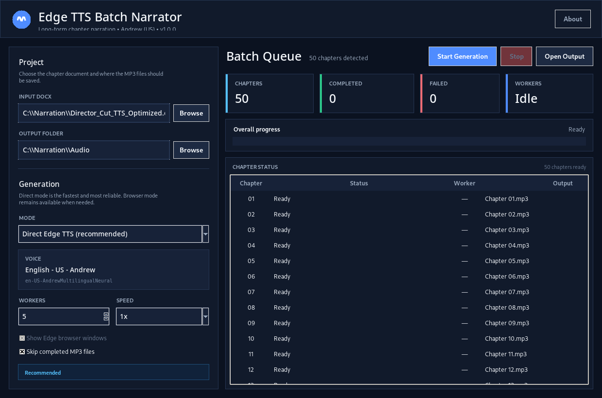

# Edge TTS batch narrator

<p align="center">
  
</p>

<p align="center">
  <strong>Turn chapter-based Word documents into MP3 narration with Microsoft Edge TTS.</strong><br>
  Andrew (English US) • 1–5 parallel workers • resume support • Windows desktop UI
</p>

<p align="center">
  
  
  
  
</p>



## What it does

**Edge TTS batch narrator** reads a `.docx` file, detects numbered chapters, and generates a separate MP3 for each chapter. It is designed for long-form narration workflows where creating dozens of chapters manually would take too much time.

The default voice is:

- **English - US - Andrew**
- Microsoft voice ID: `en-US-AndrewMultilingualNeural`

## Features

- Detects `Chapter 1`, `Chapter 2`, ... automatically from Word documents.
- Supports TTS-optimized documents with an entire chapter stored as one continuous paragraph.
- Generates up to **5 chapters in parallel**.
- **Direct Edge TTS mode** avoids fragile website dropdown automation.
- Optional **Browser UI mode** automates edge-tts.com in Microsoft Edge.
- Saves files automatically as `Chapter 01.mp3`, `Chapter 02.mp3`, etc.
- Resume interrupted projects by skipping valid MP3 files that already exist.
- Retries failed generations automatically.
- Per-chapter status, worker assignment, overall progress, and failure count.
- Remembers your most recent settings.
- Professional dark Windows desktop interface.

## Download

For normal users, download one of the Windows executables from **Releases**:

- `EdgeTTSBatchNarrator-v1.0.0-win64.exe` — fully bundled standalone build.
- `EdgeTTSBatchNarrator-v1.0.0-Setup.exe` — lightweight first-run setup build.

Both executables carry the **Edge TTS batch narrator** product title, the application icon, and version **1.0.0** in Windows file properties.

## Input format

A standard document can look like this:

```text
Chapter 1
The first chapter narration...

Chapter 2
The second chapter narration...
```

The app also supports a continuous TTS format:

```text
Chapter 1. The complete chapter narration continues in the same paragraph...
```

Each detected chapter becomes one MP3 file.

## DOCX template

A ready-to-edit template is included at:

`examples/Edge TTS batch narrator - DOCX template.docx`

It demonstrates the recommended chapter structure and TTS-friendly formatting. Replace the sample chapter text with your own narration, then select the document in the app.

## Recommended settings

| Setting | Recommended value |
|---|---|
| Generation mode | Direct Edge TTS |
| Voice | English - US - Andrew |
| Workers | 5 |
| Speed | 1x |
| Skip completed MP3s | Enabled |

If your connection becomes unstable, lower the worker count to **3** and resume using the same output folder.

## Browser mode

Browser mode is optional. It launches Microsoft Edge workers and uses the edge-tts.com interface. It performs a voice-selection preflight before starting the batch.

Requirements for Browser mode:

- Microsoft Edge installed.
- Internet connection.

Direct mode is recommended because it does not depend on website UI controls.

## Build from source

### Windows

1. Install Python 3.12 or newer.
2. Clone this repository.
3. Double-click `build_windows.bat`.
4. The executable will be created at:

```text
dist\EdgeTTSBatchNarrator-v1.0.0-win64.exe
```

For development, run `run_dev.bat`.

### Manual commands

```powershell
py -3.12 -m venv .venv
.\.venv\Scripts\Activate.ps1
python -m pip install -r requirements.txt -r requirements-build.txt
python -m PyInstaller EdgeTTSBatchNarrator.spec --noconfirm --clean
```

## GitHub release build

The repository includes `.github/workflows/build-windows.yml`.

Creating and pushing the tag `v1.0.0` automatically:

1. Builds the fully bundled Windows executable on `windows-latest`.
2. Builds the lightweight Setup executable and embeds its icon/version resources.
3. Generates SHA-256 checksums.
4. Uploads both executables as an Actions artifact.
5. Creates the GitHub Release and attaches both `.exe` files and the checksum file.

Example:

```bash
git tag v1.0.0
git push origin v1.0.0
```

## Privacy

Narration documents are read locally by the application. Text selected for speech generation is sent to the applicable online TTS service as required to synthesize audio.

## License

Released under the [MIT License](LICENSE).
